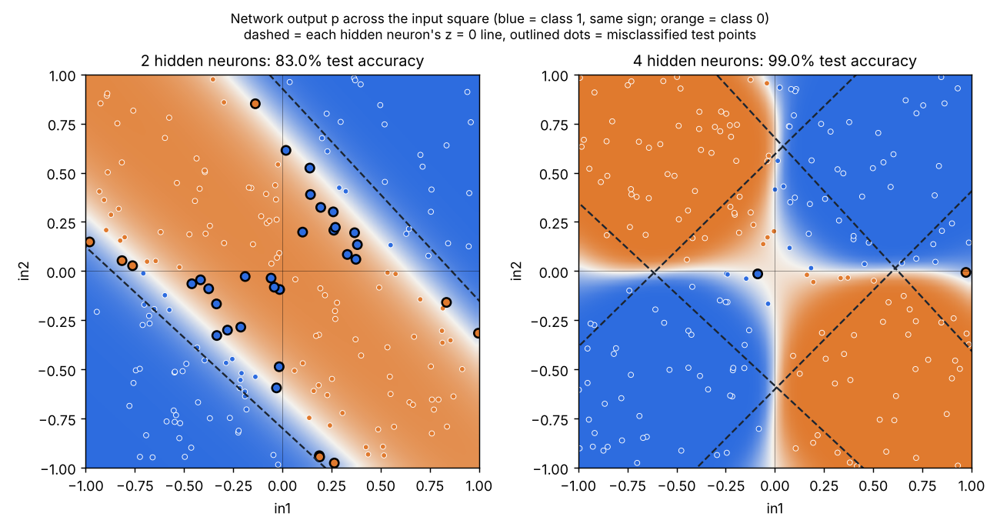

# Neural Net XOR

A small neural network written from scratch in C++ (no ML libraries) that learns the XOR pattern, a problem that a single straight-line classifier like logistic regression or a perceptron cannot solve.



## The problem

Points are drawn uniformly from the square [-1, 1]². A point is labeled **1** when `in1` and `in2` have the **same sign** (top-right and bottom-left quadrants) and **0** otherwise. That is XOR spread over a continuous plane, using the sign of each input as its bit.

No single line can separate the two blue corners from the two orange ones, so a linear model is stuck at about 50% accuracy. A hidden layer fixes this: each hidden neuron learns its own line, and the output neuron combines them into a bent boundary.

- 800 training samples, 200 held-out test samples
- Classes are roughly 50/50, so 50% is the "guessing" baseline

## The network

```
in1 ─┬─► hidden neuron 1 ─┐
     ├─► hidden neuron 2 ─┼─► output neuron ─► p (probability of class 1)
in2 ─┴─► ...  (H total) ──┘
```

- **Hidden layer:** H sigmoid neurons, each computing `h = σ(w·x + b)`
- **Output:** one sigmoid neuron on top of the hidden outputs, `p = σ(v·h + c)`
- **Loss:** average binary cross-entropy (log-loss), with `p` clamped to avoid `log(0)`
- **Training:** full-batch gradient descent, learning rate 1.0, 10,000 epochs
- **Init:** small random weights in ±0.5. All-zero weights would keep the hidden neurons identical forever, so random init is needed to break the symmetry.

### Backpropagation

For one sample with label `y`:

```
output error      δo = p − y
output gradients  ∂L/∂vj = δo · hj        ∂L/∂c = δo
hidden error      δj = δo · vj · hj(1 − hj)
hidden gradients  ∂L/∂wjk = δj · xk       ∂L/∂bj = δj
```

The gradients are averaged over the training set, then every parameter is updated with `θ -= lr · ∂L/∂θ`. I verified the backprop gradients against a numerical central-difference check `(L(θ+ε) − L(θ−ε)) / 2ε`, and all 9 parameters of the 2-hidden-neuron network matched to 7–8 significant digits.

## Results

| Model | Test accuracy | Notes |
|---|---|---|
| Logistic regression / perceptron | ~50% | One straight line, so no better than guessing |
| 2 hidden neurons | ~84% | Learns a diagonal band between two parallel lines |
| 4 hidden neurons | ~97–99% | Four lines combine into the quadrant pattern |
| 8 hidden neurons | ~98% | No better than 4, but trains reliably on every seed |

Why 2 neurons top out around 84%: if the two hidden neurons learned the axes exactly, the output neuron would have to compute XOR of their two answers, which is the same unsolvable problem one layer up. The best it can do is a band, as the left plot shows.

Extra neurons beyond about 4–6 mostly become duplicates or nearly flat "dead" neurons. They don't improve accuracy, but they make it less likely that training gets stuck on an unlucky random start.

## Build and run

**Visual Studio:** open `NeuralNet.vcxproj`, choose the **Release | x64** configuration, and run. Release matters: a Debug build is roughly 20× slower because of unoptimized code and checked `std::vector` access. The project was created with Visual Studio's v145 toolset, so older versions may ask to retarget it, which is fine.

**g++ / clang:**

```bash
g++ -std=c++17 -O2 main.cpp -o neuralnet
./neuralnet
```

The program prints the test accuracy and writes `nn_output.csv`.

To change the number of hidden neurons, edit `m.hidden.resize(4)` in `initModel`. The output neuron sizes itself from the hidden layer automatically.

## Visualizing the result

Open `tools/viewer.html` in a browser and click **Load CSV** to pick the `nn_output.csv` from a run. It shows:

- the network's output across the whole square
- the test points, with mistakes outlined
- each hidden neuron's line
- test accuracy and loss, and a table of the learned weights

The CSV has one `kind` column: `grid` rows hold p for a 60×60 grid, `test` rows hold each test sample with its label and p, and `line` rows hold each hidden neuron's weights, bias and output weight.

## Files

```
main.cpp                 the whole network: data, forward pass, loss, backprop, training, evaluation, CSV export
NeuralNet.vcxproj        Visual Studio project
tools/viewer.html        standalone page for plotting nn_output.csv
docs/decision_regions.png
```

## What I learned

- Why a hidden layer plus a nonlinearity is what lets a network go beyond straight-line boundaries
- Deriving and implementing backpropagation by hand, and checking it numerically
- Why weights must start random, not zero (symmetry breaking)
- How the number of hidden neurons trades off between accuracy and how reliably training works
- That the hidden neurons don't have to find the "obvious" lines: with 4 neurons the network built a diamond of diagonal lines whose combined vote lands on the axes

This is part of a series of from-scratch ML projects in C++ that started with linear regression, a perceptron and logistic regression, and continues with an MNIST handwritten-digit classifier.

## Acknowledgements

The network itself (data, model, forward pass, loss, backprop, training) is my own code. The CSV export function and the viewer page were written with help from Claude.
